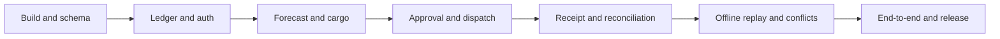

# Delivery roadmap

Estimates are planning ranges, not commitments. Assume one full-time engineer familiar with Rust and web development, occasional design review, and no live integrations. Budget roughly **8–10 weeks for v0.1**, then adjust after the first milestone. Issue estimates represent focused engineering days; allow additional integration, review, and contingency time. Multiple contributors may reduce elapsed time but offline and ledger dependencies limit parallelism.

| Milestone | Indicative window | Outcome and exit gate |
| --- | --- | --- |
| M0 — Runnable foundation | Week 1 | Original UI shell, web build/static serving, route demo, persistent schema, CI for Rust and web |
| M1 — Inventory truth | Weeks 2–3 | Catalog, ledger, import, roles, balances, persisted audit; invalid/concurrent writes tested |
| M2 — Replenishment loop | Weeks 4–6 | Forecast → draft → approve → dispatch → partial receipt → reconcile; quantity conservation verified |
| M3 — Resilient MVP / v0.1 | Weeks 7–10 | Cache/outbox/conflict handling, restore procedure, accessible UI, demo E2E, packaged release |
| M4 — Pilot / v0.2 | After v0.1; 4–6 additional weeks | Optional evidence-linked assistant, integration adapter, usage feedback, real-map feasibility study |
| M5 — Expanded planning / v0.3 | Discovery first | Multi-stop scheduling, improved forecasting, telemetry ingestion, larger deployment architecture |

M4 and M5 are directions, not v0.1 commitments. Re-estimate each after pilot evidence; do not advertise unsupported capabilities.

## Critical path

Build the UI against real API contracts early. Do not defer the first runnable vertical slice until the database and backend are “complete.” Device identity/idempotency fields enter the initial schema even though the offline UI comes later.

## First five implementation steps

1. SUS-001: establish code provenance, original name, repository ownership, and release license.
2. SUS-002: restore a runnable route demo and introduce the web build/static asset contract.
3. SUS-003: create migrations and deterministic fixtures, retaining the existing graph.
4. SUS-004: enforce Rust, web, and engine parity checks once the application builds.
5. SUS-005/SUS-006: expose catalogs and the ledger through one visible inventory screen.

## Risks and planned responses

| Risk | Response / decision point |
| --- | --- |
| Offline sync grows into a distributed system | One server, bounded cached data, queued claims, explicit conflicts; defer writable peers |
| Attractive dashboard hides incorrect stock | Ledger invariants and concurrent tests block release |
| Synthetic routing mistaken for real navigation | Label the network and measure it; real-road integration requires a separate milestone |
| Rust and JS implementations diverge | Golden comparison fixtures; Rust is authoritative for the application |
| Too little consumption history | Show manual fallback/unknown state and forecast inputs |
| UI/server build mismatch | Repair fixed missing-asset assumptions in M0 |
| Scope expands into AI and hardware | v0.1 acceptance gates remain the replenishment loop; later work stays outside the milestone |
| Single-writer contention grows | Measure pilot write load; introduce PostgreSQL only with evidence and a migration plan |

## Release checklist

- All v0.1 acceptance criteria in PRODUCT.md pass with evidence attached to issues.
- No unresolved P0/P1 defect affecting data integrity or core workflow.
- Install, seed, demo, backup, restore, and upgrade steps verified from a clean environment.
- Versioned API contract, migration policy, license, attribution, and contributor instructions present.
- Package/image contains original assets and synthetic fixtures; secrets and live database files excluded.
- Changelog explicitly separates delivered capabilities from roadmap proposals.
- Screenshots and a short demo walkthrough are generated from the implemented product.
