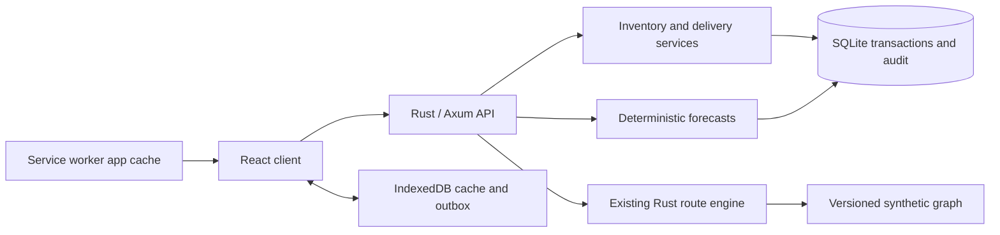

# Architecture proposal

All components below are planned unless explicitly marked existing.

## Stack and structure

Keep the existing Rust routing code and Axum service. Add a React/TypeScript application built with Vite, a SQLite database, explicit SQL migrations, and a browser IndexedDB cache/outbox. Use one service and one database per deployment. This fits the local/self-hosted MVP and avoids operating a queue, vector database, and separate forecasting service before they are needed.

[Axum](https://docs.rs/axum/latest/axum/) provides the existing HTTP foundation. [React](https://react.dev/learn) provides the proposed component UI. [SQLite's deployment guidance](https://sqlite.org/whentouse.html) supports application-local storage; keep the database on local disk rather than a shared network filesystem. Reassess PostgreSQL when concurrent write demand or multi-instance operation justifies it.



Target layout after the first implementation milestone:

```text
web/                    React/TypeScript source and build configuration
web/dist/               Generated assets, ignored by Git
src/main.rs             API wiring and static-file serving
src/routing.rs          Existing solver, retained initially
src/inventory.rs         Ledger and reservation rules
src/deliveries.rs        Delivery state machine
src/forecast.rs          Consumption and replenishment calculations
src/sync.rs              Outbox acceptance and change feed
src/auth.rs              Sessions, roles, and authorization
migrations/             Versioned SQLite schema migrations
data/                   Synthetic fixtures, not live databases
tests/                  API, concurrency, and browser scenarios
dev/                    Existing JS reference engine and comparison fixtures
docs/                   User, architecture, and contributor documentation
planning/               Backlog and GitHub board configuration
```

The existing servers use fixed `include_str!`/file reads for absent `web/*` assets. SUS-002 must deliberately replace that arrangement with a documented web build and static asset serving; adding React source alone will not fix startup. Keep JavaScript as a route reference, not a second implementation of the new backend business rules.

## Domain model

| Entity | Important fields and rules |
| --- | --- |
| Location | UUID, name, graph node ID, optional geographic coordinates |
| Item | UUID, SKU, base unit, quantity scale, mass and volume per base unit |
| Stock event | UUID, location/item, signed quantity, type, actor, occurred/received timestamps, source operation ID, correction reference |
| Reservation | UUID, delivery line, item/source, quantity, status; transactionally constrained against available stock |
| Vehicle | UUID, label, tare mass, payload mass/volume, height, max grade, availability version |
| Delivery | UUID, source/destination, vehicle, state, version, route snapshot/revision, planned departure, actor timestamps |
| Delivery line | Item, planned/reserved/dispatched/received quantities and reconciled discrepancy |
| Consumption policy | Location/item, manual rate, lead days, safety days, target days, version |
| Audit event | Actor, action, entity/version, before/after summary, server timestamp, correlation ID |
| Accepted operation | Actor/device scope, client operation UUID, payload hash, result, server sequence |
| User/session | User ID, role, enabled state, expiring server session |

Use UUIDs for domain objects; retain numeric graph node IDs inside a versioned graph adapter. Store quantities as scaled integers and convert only at API boundaries. Store times as UTC; display local time. Do not use device clocks to determine write precedence. Server sequence numbers drive incremental synchronization.

## Stock and delivery invariants

Inventory is an append-only event ledger with materialized balances updated in the same database transaction. Corrections are explicit compensating events. Audit records are application-append-only, not claimed to be tamper-proof against database administrators.

Delivery states: draft → approved → dispatched → partially_received → completed. Draft/approved may be cancelled. Cancellation of approved work releases reservations. Dispatched deliveries require an explicit return or discrepancy event rather than cancellation that erases stock movement.

- Draft: no stock movement. Feasibility results are proposals tied to graph and inventory versions.
- Approval: revalidate quantities, vehicle assignment, graph freshness, and permissions; create reservations atomically.
- Dispatch: consume reservations, subtract source on-hand, add in-transit, and lock dispatched quantities atomically.
- Receipt: decrement remaining in-transit and increment destination on-hand. Partial receipts are allowed; duplicate or excess receipts are rejected.
- Completion: all dispatched quantity is either received, returned, or reconciled by a coordinator with a reason.
- A physical count is an observation. A coordinator applies its difference as a version-checked adjustment, preventing a stale offline count from overwriting intervening receipts.
- A vehicle cannot have overlapping approved delivery intervals. Reserve its interval with the stock reservation transaction; invalidate a proposal when upstream versions change.

Use database transactions, constraints, and a unique operation key. A client retry with the same key and same payload returns the stored result; the same key with different content is a conflict. Test concurrent writers rather than relying on disabled UI buttons.

## API boundaries

Version new endpoints under `/api/v1`. Existing `/api/network` and `/api/route` are prototype endpoints; document migration and preserve reference fixtures.

| Endpoint | Purpose |
| --- | --- |
| `GET /api/v1/locations`, `/items`, `/vehicles` | Read catalogs with pagination |
| `POST /api/v1/locations`, `/items`, `/vehicles` | Role-checked catalog creation |
| `GET /api/v1/inventory?location_id=...` | Balances and observation freshness |
| `POST /api/v1/stock-events` | Validated consumption/receipt/adjustment event |
| `POST /api/v1/imports/preview`, `POST /api/v1/imports/{id}/commit` | Validated, versioned CSV import |
| `GET /api/v1/shortages` | Explainable estimates and inputs |
| `POST /api/v1/routes/plan` | Constraint-aware route proposal |
| `POST /api/v1/deliveries` | Draft delivery with cargo |
| `POST /api/v1/deliveries/{id}/approve`, `/dispatch`, `/receipts`, `/cancel`, `/reconcile` | Explicit state transitions |
| `POST /api/v1/sync/operations` | Accept per-operation queued field claims |
| `GET /api/v1/sync/changes?cursor=...` | Ordered changes including tombstones |
| `GET /api/v1/audit?entity_id=...` | Authorized history |
| `GET /health`, `GET /ready` | Process health and database readiness |

Mutations include `operation_id` and, where applicable, `expected_version`. Standard errors: code, message, field errors, correlation ID, and current version for conflicts. Return 401/403 for authentication/authorization, 409 for stale versions or key reuse, 422 for domain validation, and 413 for oversized payloads. Avoid exposing internal SQL or credentials.

## Offline contract

The MVP supports a browser disconnected from a single authoritative server. It does not implement distributed server consensus or mesh networking.

1. After first successful online initialization, cache the application shell and a bounded authorized snapshot. Label each view with its last confirmed server update.
2. Write permitted stock observations and receipt claims into IndexedDB with stable operation IDs before showing “saved on this device.” Queued receipt claims do not become confirmed stock until accepted by the server.
3. Attempt synchronization on application startup, reconnection, and explicit retry, with bounded backoff. Background Sync may supplement this but cannot be required: [MDN documents limited browser availability](https://developer.mozilla.org/en-US/docs/Web/API/Background_Synchronization_API).
4. Process each queued operation independently and return accepted, rejected, or conflict. Persist outcomes and server cursors transactionally in the local cache. Do not reapply accepted operations after a crash.
5. Preserve conflicts for user resolution. Never silently use last-write-wins for stock counts, reservations, or delivery states.
6. Require online revalidation for approval and dispatch. Expired sessions stop uploads until reauthentication. Clear scoped caches on logout and prevent a different account from accessing the previous user's data.
7. Detect quota/storage errors and report unsaved data. Test browser storage limitations; offline initialization and retention are capabilities with explicit bounds, not unconditional guarantees.

## Routing limits and future growth

The existing solver handles a small undirected graph, ground/ferry modes, gross-weight/height/grade limits, closure windows, weather multipliers, and ferry timing. It does not solve multi-stop vehicle routing, cargo allocation, real road navigation, or complete fleet scheduling. Keep result explanations for excluded edges and wait time. Add graph validation and request parity fixtures before expanding it.

Route calculations should run with bounded graph/request sizes. Persist the graph revision and request with each approved plan. Treat later network changes as alerts that require replanning before dispatch.

## Security, deployment, and verification

v0.1 is single organization, with Viewer, Operator, Coordinator, and Admin permissions enforced by the server. Use local users and secure password hashing, expiring HttpOnly sessions, CSRF protection, same-origin hosting, and login rate limits. Add OIDC in a later release if deployment demand warrants it. Run locally by default; remote self-hosting requires TLS and configured sessions. Demo fixtures contain no real operational records.

Deliver a container image, explicit database volume, migrations, health checks, and documented backup/restore. Do not enable telemetry or external AI by default. External assistant calls are a later opt-in adapter, read-only initially, with sourced answers and no direct mutation authority.

Testing layers: routing unit/parity tests; ledger and forecast unit tests; API/auth/state-machine integration tests; concurrent reservation and retry tests; browser completion of the demo; disconnect/reload/replay/conflict tests; migration and restore smoke tests. Include input fuzz/property testing for malformed graph/request data as a post-baseline hardening task.
