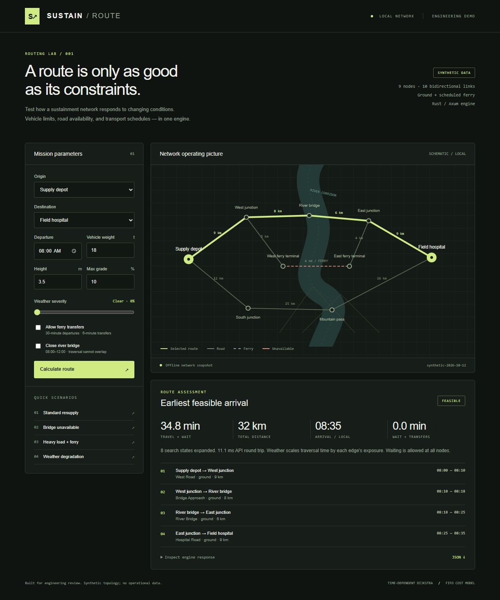

# Sustain Route — runnable portfolio demo

This demo demonstrates original Rust graph search and cost modeling, exposed through an Axum API with a diagnostic UI. All data is synthetic.



## Run

With the workspace-local toolchain installed during this session:

```powershell
.\scripts\rust.ps1 run
```

With a normal Rust installation: `cargo run`. Open http://127.0.0.1:8080.

Without Rust: `npm start` runs the dependency-free JavaScript reference server. Stop either server before starting the other; both default to port 8080. The UI identifies which engine is active. Rust binds to loopback; override using `BIND_ADDR`. The reference server uses `PORT` and binds to loopback.

## Five-minute interview walkthrough

1. **Standard resupply:** show the bridge route for an 18 t truck: 32 km, 34.8 minutes. Inspect the response JSON and edge-by-edge times.
2. **Bridge unavailable:** closure 08:00–12:00. Waiting is compared with detouring; the southern route wins at 43 km, 59.8 minutes.
3. **Heavy load + ferry:** a 35 t truck cannot use the 24 t bridge; a 4% maximum grade excludes the mountain route. Ferry transport adds loading, scheduled waiting, crossing, and unloading. It arrives at approximately 09:04 after a departure at 08:00.
4. **Weather degradation:** change weather severity and explain exposure-weighted edge costs. Costs affect the search itself, not only the final ETA.
5. **Failure case:** set weight to 90 t. The engine reports no feasible route rather than ignoring hard limits. Restore Standard resupply.

Start the technical discussion in `src/routing.rs`. Explain why the state includes incoming mode, why waiting preserves FIFO, and why production turn restrictions would require incoming-edge state. This is an original engine demo; it does not demonstrate an implemented Valhalla patch or substitute for professional experience.

## Implemented semantics

- Bidirectional adjacency graph; binary heap earliest-arrival Dijkstra on node × incoming mode.
- Gross-weight, height, and maximum-grade hard restrictions; ferry permission.
- Travel time: `60 × km / speed_kph × (1 + severity × exposure × 2)`.
- Half-open closure intervals evaluated over the entire predicted traversal. Waiting allowed at every node.
- Regular ferry departures, with loading/unloading penalties. Timetable rechecked after closure waiting.
- Immutable bundled topology and query-specific operational overlays; graph revision returned.
- Structured legs with drive, transfer, closure wait, and schedule wait. Hard vehicle exclusions describe the whole graph.

Weather is fixed during a query. No real coordinates, OSM ingestion, turn restrictions, live feeds, capacity reservations, air transport, generalized risk costs, database, authentication, or cloud deployment are implemented. This is a small local demonstrator.

## API

`GET /health`, `GET /api/network`, `POST /api/route`.

```json
{"origin":0,"destination":4,"departure_minutes":480,"weight_tonnes":35,"height_m":3.5,"max_grade_pct":4,"weather_severity":0,"allow_ferry":true,"closures":[]}
```

Time values use minute offsets from a synthetic local day. Closure objects contain `edge_id`, `start`, and `end`. Invalid parameters or infeasible routes return 422. JSON extraction also rejects malformed input. API round-trip duration in the UI is not an engine benchmark.

## Verification — October 12, 2026

- Rust compiled successfully; all **10 Rust tests** passed.
- All **13 JavaScript reference tests** passed.
- `cargo clippy --all-targets -- -D warnings` passed; Rust source formatted with rustfmt.
- Rust HTTP checks passed for the baseline route and 422 infeasible-vehicle response.
- Browser verified Rust baseline, scheduled ferry, weather, and infeasible route behavior. Closure detour verified against the reference server.
- Screenshot captured from the running Rust backend. No runtime remote services are required.

Repeat with `cargo test` (or `.\scripts\rust.ps1 test`) and `npm test`.

The [Valhalla milestone](valhalla-plan.md) describes a proposed direct C++ engine extension. It distinguishes that future work from the current implementation and links official Valhalla sources. Axum API usage follows its [official documentation](https://docs.rs/axum/0.8.9/axum/).
